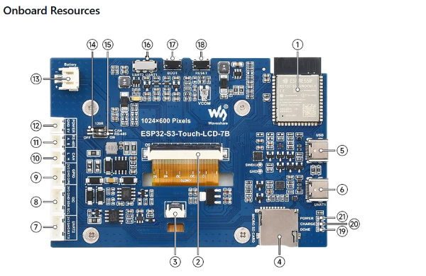
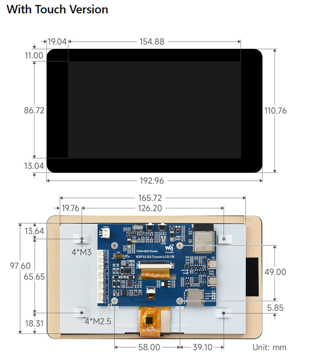

# House V Touch Console

Firmware, touchscreen projects, and enclosure CAD for a House V console built around the Waveshare ESP32-S3-Touch-LCD-7B development board.

## Board at a glance

| Feature | Specification |
| --- | --- |
| Display | 7-inch, 1024 × 600 color LCD with touch |
| Processor | Dual-core ESP32-S3, up to 240 MHz |
| Module | ESP32-S3-WROOM-1-N16R8 |
| Memory | 16 MB flash and 8 MB PSRAM |
| Wireless | Wi-Fi and Bluetooth LE, onboard antenna |
| Interfaces | USB-C, USB-to-UART, microSD, UART, I²C, sensor, CAN, RS-485, battery header |

The connector diagram and mechanical drawing below are cropped from Waveshare's product resources. The original reference files are included under [`hardware/enclosure/reference/`](hardware/enclosure/reference/).

### Board interfaces

### Display and board mounting dimensions

## Enclosure CAD

The first-fit enclosure is modeled around the manufacturer's mechanical STEP reference. The exported STEP has three separate bodies: the front bezel with its recessed logo pocket, the rear housing, and the matching inlay. The inlay is a second-color badge with `HOUSE V` cut through it so the case color shows through the letters.

- [Open the enclosure STEP in SolidWorks](hardware/enclosure/Waveshare_7B_Enclosure.step).
- [FreeCAD source generator](hardware/enclosure/build_case.py) regenerates the STEP, FCStd, STL, and build report files. It requires FreeCAD with the Draft workbench module.
- [Front bezel STL](hardware/enclosure/Front_Bezel.stl), [rear housing STL](hardware/enclosure/Rear_Housing.stl), and [HOUSE V inlay STL](hardware/enclosure/HouseV_Inlay.stl) are separate print files.
- [Manufacturer board STEP](hardware/enclosure/reference/ESP32-S3-Touch-LCD-7B-20251025.stp), [PDF drawing](hardware/enclosure/reference/ESP32-S3-Touch-LCD-7B-20251025.pdf), and [DWG drawing](hardware/enclosure/reference/ESP32-S3-Touch-LCD-7B-20251025.dwg) are kept as design references.

### Current enclosure dimensions

- Outer case: **208.96 × 126.76 × 22.90 mm**.
- Display envelope from the reference assembly: **192.96 × 110.76 × 18.40 mm**.
- PCB mount pattern: four points on **58 × 49 mm** spacing.
- Board-mount screw paths: **2.8 mm through-holes** with **5.4 mm diameter × 1.5 mm deep** recessed seats on the outside of the rear housing.
- Case halves: four separate M3 screws pass through the front face into blind pilots in the backing.
- HOUSE V mark: recessed **0.75 mm** into the lower bezel band; the inlay sits **0.10 mm** below the front surface and is a separate STEP body and STL for second-color printing.

These are prototype dimensions. Confirm the screw fit, board orientation, connector openings, and clearances against the physical board before printing the final enclosure. Connector access cutouts are not included yet. Check whether the board's mounting holes are threaded or need another retention method before selecting the M2.5 fasteners.

## Project status

The enclosure and board references are the initial hardware work. Firmware and touchscreen applications will be added as their use cases are defined.

## Manufacturer resources

[Waveshare ESP32-S3-Touch-LCD-7B resources and documents](https://docs.waveshare.com/ESP32-S3-Touch-LCD-7B/Resources-And-Documents)
